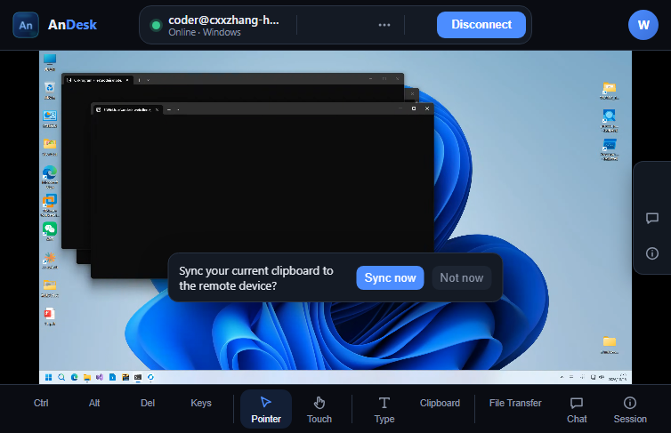
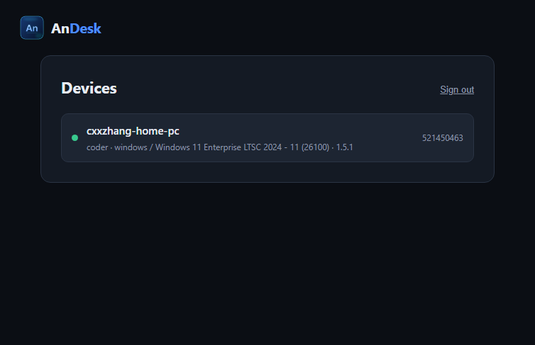

# andesk-webclient

浏览器里控制 RustDesk 设备的 Web 客户端。**自带界面**，不依赖官方 Flutter Web 构建，
也不依赖付费的 Server Pro。

- 协议：RustDesk 的 rendezvous / relay / message 三套 protobuf，走 WebSocket 中继
- 视频：WebCodecs（VP8/VP9/H.264/AV1 硬件解码）；非安全上下文回退 H.264 + MSE
- 服务端：任何 OSS `hbbs`/`hbbr`（本仓库用 rustdesk-server 1.1.17 实测）
- 许可：AGPL-3.0 —— 见 `ATTRIBUTION.md`，**商用前务必读**

## 当前状态

| 部分 | 状态 |
|---|---|
| 协议栈（信令 → 中继 → NaCl 握手 → 登录 → 视频帧） | ✅ **已端到端实测**（无头驱动） |
| 浏览器界面 + 真实远程会话 | ✅ **已实测**（Edge 无头驱动，画面 2560×1440） |
| 白标（名称/图标/主色） | ✅ 已换（`AnDesk` + 取自 `andesk.ico` 的蓝色系） |
| 账号登录 + 设备列表（接 API 服务端） | ✅ **已实测**（登录 → 列表 → 点一下进客户端） |
| 生产部署（wss 反代） | ✅ 配置已给（`deploy/Caddyfile`），未在真机域名验证 |
| 音频 | ⚠️ 代码在，实测未收到帧（可能默认没开） |
| 文件传输 / 剪贴板 | ⚠️ 面板与协议在，未逐个验证 |
| WebRTC UDP P2P | ✅ **已实测**（3/3 局走直连；需给 hbbs 打补丁，见下） |



截图里是浏览器中一次真实的远程会话：画面为受控机桌面（2560×1440），
顶部显示 `coder@cxxzhang-home-pc Online · Windows`，底部是完整工具栏。

协议部分也不是"看起来能跑"，是真的跑通了。无头驱动的实测输出：

```
[0.0s] state -> rendezvous
[0.0s] state -> relay          # 收到 hbbs 的 RelayResponse，验签通过
[0.0s] state -> handshake      # 已连 hbbr，NaCl 握手完成
[0.0s] state -> login          # 密码交换完成
[0.8s] state -> streaming      # 第一帧到达
RESULT: videoFrames=18 audioFrames=0
```

## 本机已验证的配置（可直接照抄）

```toml
# 受控端 %APPDATA%\RustDesk\config\RustDesk2.toml
[options]
custom-rendezvous-server = '127.0.0.1'
relay-server = '192.168.32.1'     # ← 必须是非回环地址，见下面第 1 个坑
key = '<hbbs id_ed25519.pub>'
```

```
hbbs.exe -r 192.168.32.1:21117    # ← 中继地址也广播成非回环
hbbr.exe
```

然后 `npm run serve` → 打开 `http://localhost:8080/?peer=<设备ID>` → 输密码 → 连上。

## 产品流程（`/` 是启动页）



`/` 是登录页，`/index.html?peer=<设备ID>` 是客户端本身。一条完整的链路：

```
/  →  登录（POST /api/login）
   →  GET /api/devices 列出你的设备（在线状态、主机名、系统、版本）
   →  点设备  →  /index.html?peer=<id>
   →  输一次设备密码（勾"记住密码"后下次自动进）
```

`?peer=` 直接打开 `/` 也能用 —— 启动页会直接跳到客户端，分享链接/收藏不受影响。

**为什么要同源反代 `/api`**：`rustdesk-api-server-pro` 不发 CORS 头，
浏览器从 :8080 直连 :12345 会被拦。`scripts/server.mjs` 和 `deploy/Caddyfile`
都把 `/api/*` 转到它，所以页面只跟同源打交道。生产里改 `apiBase` 或让反代指向你的控制台。

## 快速开始

```bash
npm install
npm run gen          # 从 protos/ 生成 src/gen/*.ts
npm run build        # -> dist/{app.js,session.worker.js,app.css,index.html,config.js}
npm run serve        # http://localhost:8080 + /ws/id、/ws/relay 反代
```

改 `web/config.js`（或首次 `npm run build` 后改 `dist/config.js`）：

```js
window.__RD_CONFIG = {
  serverKeyB64: '<hbbs 的 id_ed25519.pub 内容>',
  wsIdUrl: 'ws://localhost:8080/ws/id',
  wsRelayUrl: 'ws://localhost:8080/ws/relay',
  myName: 'webclient',
};
```

打开 `http://localhost:8080` → 登录（默认 `admin / admin123`，请务必改掉）→ 点设备 → 输设备密码。

也支持用链接传参：`?peer=123456789&key=<公钥>&wsid=...&wsrelay=...`

`npm run serve` 一个进程干三件事：发静态文件、把 `/ws/id` `/ws/relay` 反代到
hbbs/hbbr、把 `/api` 反代到控制台。参数可调：
`node scripts/server.mjs --port 8080 --id 127.0.0.1:21118 --relay 127.0.0.1:21119 --api 127.0.0.1:12345`。

### 分享链接（限时）

给客户发一条链接，对方粘贴进浏览器 → **只剩密码框** → 输密码即连。

```bash
curl 'http://localhost:8080/share?peer=521450463&ttl=600'
# -> {"url":"http://host/s/<token>","peer":"521450463","expires":...,"ttl":600}
```

`/s/<token>` 打开时**服务端**验证签名（HMAC-SHA256），通过才把设备 ID 注入页面。
不通过返回 410（过期）/ 403（签名不对），而不是把客户端页面发出去。

- **签名必须在服务端**。页面能算的签名，访问者也能算，那就不是签名。
  所以 `SHARE_SECRET` 是服务端环境变量（没设就每进程随机生成一个，重启即失效）。
- **链接里不放设备密码**。那是受控机的凭据，即使链接过期它也照样能用——
  放进会留在浏览器历史和聊天记录里的 URL，就超出了"限时"的意义。
  所以分享链接只免掉「输入设备 ID」，密码仍需本人提供。
- `ttl` 默认 600 秒，上限 24 小时（`--share-ttl` / `--share-ttl-max` 可调）。
- 生产环境要把 `/share` 放到控制台的会话鉴权后面（谁能分享哪台设备是控制台的事），
  并把 `/s/*` 一起反代；`deploy/Caddyfile` 已预留 `handle /s/*` 的位置。

## 上线部署

`deploy/Caddyfile` 是一个能直接用的边缘配置：一个 origin 同时提供静态客户端和
两个 WebSocket 端点（`/ws/id` → 21118，`/ws/relay` → 21119），Caddy 自动签证书。

```bash
npm ci && npm run gen && npm run build      # 产出 dist/
# 把 dist/ 和 deploy/Caddyfile 部署到服务器，改掉 Caddyfile 里的域名
caddy run --config deploy/Caddyfile
```

然后把客户端指向它（`dist/config.js` 或链接参数）：

```js
wsIdUrl:    'wss://rd.example.com/ws/id',
wsRelayUrl: 'wss://rd.example.com/ws/relay',
```

**TLS 不是可选项**：https 页面打不开 `ws://`，而且只有安全上下文才有 WebCodecs
（硬件解码）。用 nginx 也行，关键是这两条路径转发 + `Upgrade`/`Connection` 头透传。

服务端侧要满足的两条：

1. `hbbs` 广播**非回环**的中继地址：`hbbs -r <公网或LAN IP>:21117`
   （否则受控端会踩下面第 1 个坑）
2. 21118/21119 **不要直接暴露**（hbbr 无条件信任 `X-Real-IP`，直连可伪造 IP），
   只让反向代理进来

## 三个必须知道的坑

### 1. hbbr 会把「回环地址 + 明文 TCP」的连接当成管理命令通道

`rustdesk-server/src/relay_server.rs` 的 `handle_connection`：

```rust
if !ws && ip.is_loopback() {
    // 当作 console 命令处理（check_cmd），然后
    return;              // 永远不进 make_pair_，中继配对根本不会发生
}
```

**后果**：如果受控端的中继地址配成 `127.0.0.1`（本机自测的默认写法），
它的明文 TCP 请求会被 hbbr 吃掉，日志里什么都不打印，表现为
受控端报 `Failed to create relay connection ... os error 10053`
或者 `Failed to receive public key`，而 hbbr 只看到浏览器这一侧。

**解法**：让受控端用**非回环**地址连中继：

```
hbbs.exe -r <本机LAN IP或公网IP>:21117
# 以及受控端 RustDesk2.toml:
relay-server = '<同一个 IP>'
```

浏览器侧不受影响 —— 它走 WS（`ws=true` 会跳过那个分支）。

### 2. WebRTC 需要给 hbbs 打补丁（上游没有）

上游 rustdesk 的受控端在发出**任何** WebRTC 信令（SDP answer、ICE 候选）之前，
都要求 rendezvous 服务器先做一次密钥交换（`secure_tcp_required`）；失败就直接
**丢弃**信令降级中继，绝不发明文。而**上游 hbbs 从未实现这个密钥交换**，
所以官方服务器下 WebRTC 必然不可用（症状：对端日志
`failed to secure the WebRTC ICE candidate connection` /
`relaying without the WebRTC answer`）。

我们的 fork `E:\NetJobs\rustdesk-server` 补了三处（详见该仓库的改动）：

1. **密钥交换**：对端连接进来后等服务器先发言，所以开头 500ms 内没收到消息的连接
   主动回 `KeyExchange`（用 hbbs 的 Ed25519 私钥签 `KX_PARAMS_DOMAIN + KxParams`），
   之后该连接的收发都走 secretbox。注意控制器（浏览器）**不吃**这个握手，
   必须先探一下对方是否先说话，否则会把控制器的连接搞断。
2. **`PunchHoleResponse` / `RelayResponse` 转发时带上 `webrtc_sdp_answer`**
   （上游两个 handler 都没拷贝这个字段，answer 永远到不了控制器）。
3. **`IceCandidate` 分支继续读**（不能返回 `false`），且发 ICE 时用**不摘走**
   控制器 sink 的发送路径 —— trickle 有多个候选，摘一次就全丢了。

浏览器侧还有两条容易踩的：

- 中继和数据通道是**两条独立连接、两套独立握手密钥**。会话必须跑在对端 `SignedId`
  到达的那条上（`src/core/session.ts` 的 `transport`）；拿一条的密钥回给另一条，
  对端会报 `box decryption failure`。
- 数据通道上**没有** secretbox 层 —— rustdesk 认为 DTLS 已经是加密
  （`webrtc.rs` 的 `set_key` 是空实现，"the secretbox key is unused"），
  所以数据通道里跑的是**明文 protobuf**。只有中继才需要加密。
- **测了 30 秒再下结论**：直连赢下握手后，对端就放弃中继那半握手并在
  `CONNECT_TIMEOUT`（18s）后关掉中继 socket。如果会话判定"中继断了 = 会话断了"，
  每个 WebRTC 会话都会在 18 秒自杀。会话只该在**它实际用的那条**通道断时才算断。
- 浏览器**没有** `RTCPeerConnection`（老版本 / 被禁用）时不要发 offer：offer 是主线程
  造的，发出去只会等一个永远不来的回复，会话卡在 `connecting`。

#### TURN

只跑 STUN 时同一 NAT 后能直连，跨 NAT 才需要 TURN。

`tools/turnserver/` 是自带的 TURN（pion，Windows 上 coturn 不好跑）。起法：

```bash
go build -o andesk-turn.exe .
./andesk-turn.exe -public-ip <对外IP> -port 3478 -realm andesk \
  -rest-secret <共享密钥> -ice-http 127.0.0.1:3479
```

**凭证不放静态文件。** `web/config.js` 是任何人都能读的静态文件，密钥写进去等于公开。
所以 TURN 进程用 `-ice-http` 自己提供一个端点：

```
GET /ice-servers.json → {"iceServers":"turn://<expiry>:andesk:<HMAC>@host:3478"}
```

这是 coturn 的 `use-auth-secret` 方案（TURN REST API）：用户名带过期时间，密码是
`HMAC-SHA1(secret, 用户名)`。**密钥只在服务端**，页面拿到的是短时凭证，被抄走也很快失效。
客户端 `web/boot.js` 启动时去取，取到就覆盖 `config.js` 的值（`src/ui/app.ts` 在**建 peer
时**才读，所以晚到的答案也算数）；静态部署没有这个端点就 404，静默沿用 `config.js`。

生产（Caddy `file_server`）要把这个路径转给 TURN 进程，`deploy/Caddyfile` 里已加：

```caddy
handle /ice-servers.json { reverse_proxy 127.0.0.1:3479 }
```

⚠️ **两种凭证同时接受，这是有意的。** 浏览器从服务器拿凭证（短时，因为页面可被读），
而受控端是客户机上的原生 rustdesk，凭证在它自己的配置里、并非公开，且它**没有能力**生成
时限凭证。只认时限凭证会让每一台已部署的被控端失效。

#### 直连中途断了会自动回退中继

直连建立后对端就**放弃**了中继那半握手（密钥对随连接作废），所以没法原地切回——
`app.ts` 的做法是**整条重连一次，并关掉 WebRTC**，让对端走中继应答（`fallBackToRelay`）。
只回退一次，之后稳定在中继上，不会来回抖。

触发条件是"**直连已经在推流、然后断了**"（`directWasStreaming`）：连都没连上就失败
（密码错、对端忙）是普通连接失败，不该被伪装成"回退成功"。

### 3. 中继路径必须以 WS 暴露

浏览器不能开裸 TCP，所以 hbbr 的 21119（WS）必须能从页面访问到。
`scripts/server.mjs` 就是把 `/ws/id` → `hbbs:21118`、`/ws/relay` → `hbbr:21119`。
生产环境请换成 TLS 反代（`wss://`）——https 页面不允许连 `ws://`，
而且只有安全上下文才有 WebCodecs。

## 架构：核心是可替换的

```
src/core/      ← 协议核心（sans-IO）。UI 只经 contracts.ts 的类型边界调它
src/transport/ ← WebSocket 封装
src/media/     ← WebCodecs 解码 + MSE 回退
src/input/     ← 鼠标/键盘/剪贴板
src/ui/        ← 客户端界面（app.ts 190KB，自带 DOM，挂在 #rd-root）
src/gen/       ← protos 生成，勿手改
src/launcher.ts ← 登录 + 设备列表页（**我们的代码**，不是 vendored）
src/brand.ts    ← 白标（名称/图标/配色；**我们的代码**）
web/            ← 页面外壳：index.html / launcher.html / boot.js / config.js / logo
```

`src/core/`、`src/launcher.ts`、`src/brand.ts`、`scripts/` 是我们自己的；
`src/core/` 以外的 vendored 部分见 `ATTRIBUTION.md`，改动都由
`scripts/apply-local-patches.py` 施加，上游重同步不会丢。

`src/core/session.ts` 不碰任何浏览器 API —— 给它 `SessionConfig`
（ws 地址 + 服务端公钥 + peerId/密码）和一组 sink，它就把字节流跑完。
这带来两个好处：

- 可以在 Node 里无头验证整条链路（`scripts/drive-session.mjs`）
- 将来若要摆脱 AGPL、走 clean-room 自研，**只重写 `src/core/`，UI 不用动**

## 无头验证

不需要浏览器就能验证协议栈：

```bash
# 受控端要先设好固定密码。便携版 `rustdesk.exe --password` 需要装到系统+管理员权限，
# 用不了；直接改 %APPDATA%\RustDesk\config\RustDesk.toml 的 password 字段即可：
#   password = '<明文>'      ← 被控端对「解码不出 h1」的值按明文兼容处理
#   salt     = '<已存在的值>'
# 注意：这是明文落盘，仅适合测试机。正式环境请在客户端界面里设密码。
export TSX_TSCONFIG_PATH=scripts/tsconfig.harness.json
node --import tsx scripts/drive-session.mjs <peerId> <password> \
  ws://127.0.0.1:8080/ws/id ws://127.0.0.1:8080/ws/relay <serverKeyB64>
```

浏览器侧同样可以无头验证（用机器上已有的 Edge/Chrome，无需下载）：

```bash
node scripts/browser-check.mjs --url "http://localhost:8080/?peer=<设备ID>" \
  --connect <设备ID> <密码> --shot docs/session.png
```

它复用 `src/core/session.ts`，把状态迁移、收到的事件、视频帧数都打出来。
界面出问题时，用它先确认是协议问题还是渲染问题。

三个开关，排障时很有用：

- `--watch <秒>` 连上后**继续采样**，而不是一看到 "Online" 就停。
  只在开局看是看不出"跑一会儿才断"的那类问题的（见上面第 2 个坑里 18s 那个）。
- `--no-webrtc` 在点击连接前删掉 `RTCPeerConnection`，只跑中继，
  用来验回退路径。
- `--shot-live <文件>` 在**会话还活着**的时候截图（`--shot` 是脚本最后才截，
  那时失败的会话已经退回连接页了，什么都证明不了）。

排障顺序：`id ws open` → `relay ws open` → `state -> streaming`。
卡在 `handshake` 基本就是上面第 1 个坑。

## 后续

1. **真实浏览器验证** + 白标（界面在 `src/ui/app.css` / `app.ts`）
2. **接自己的 API 服务端**：现在登录靠手输设备 ID + 密码；接上
   `rustdesk-api-server-pro` 后可做账号登录、地址簿、分享链接
3. **WebRTC UDP P2P** —— 已完成并实测通过：
   - 直连 + 中继两条路都通，中继用自带 TURN，凭证由服务端**限时签发**
   - 直连中途失效会**自动重连走中继**（一次性，不来回抖）
   - 还需在真机验证的：跨真实 NAT 的 TURN 中继（本机是同一 NAT 下的直连）

## 许可

AGPL-3.0。这不是选择，是继承：协议核心来自 CortenDesk（AGPL），
schema 来自 RustDesk（AGPL）。卖服务的话 §13 要求你向用户提供对应源码，
想闭源只有 clean-room 自研或买商业授权。详见 `ATTRIBUTION.md`。
